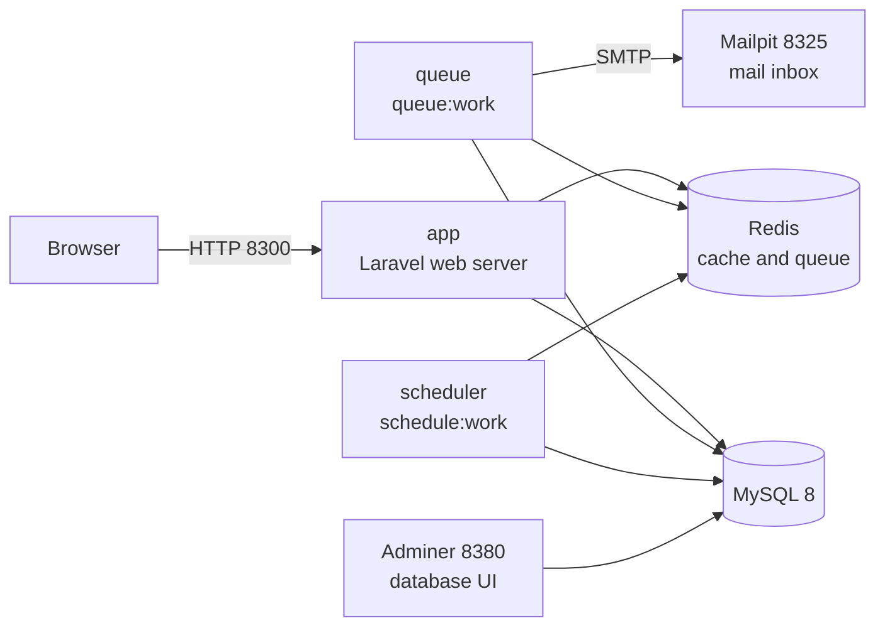
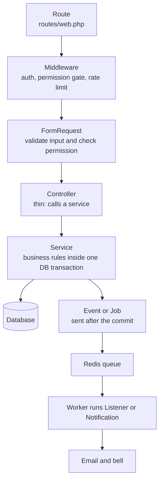
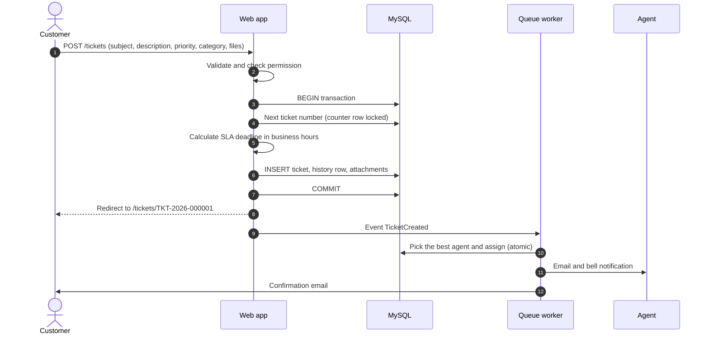
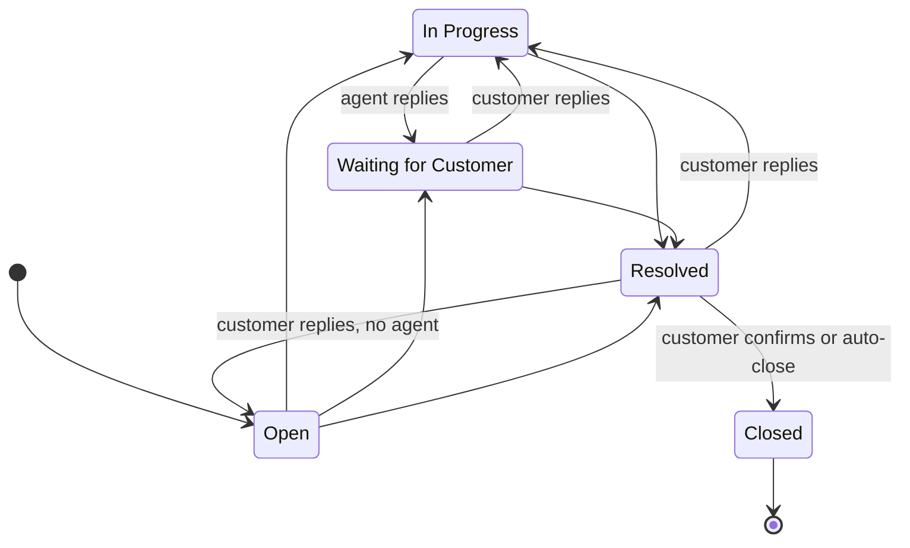
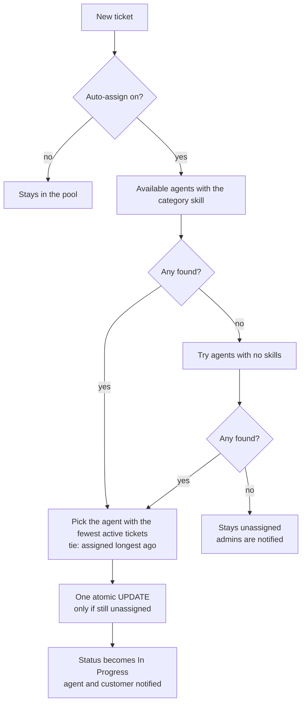
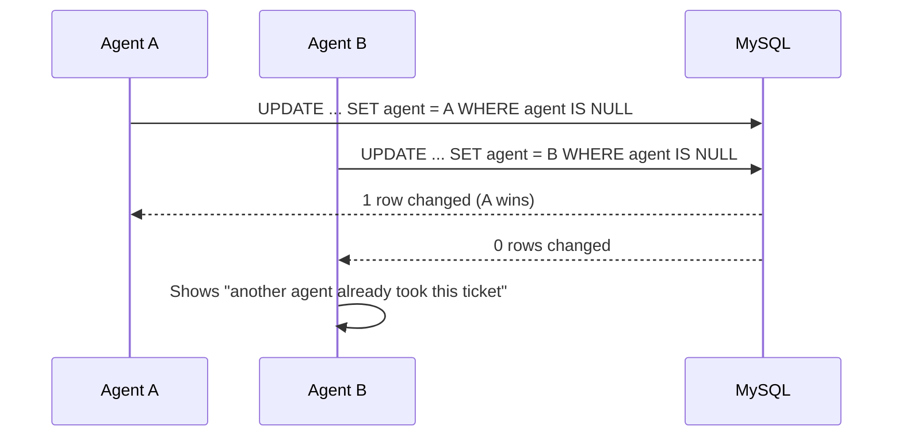
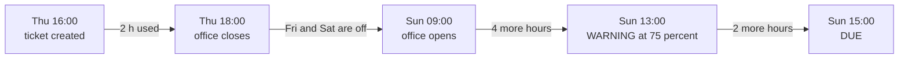
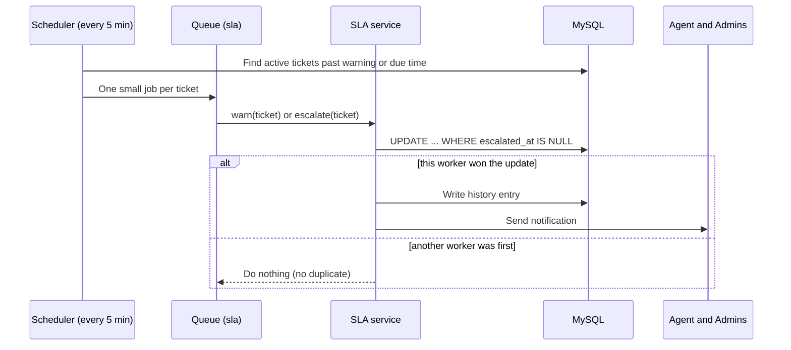
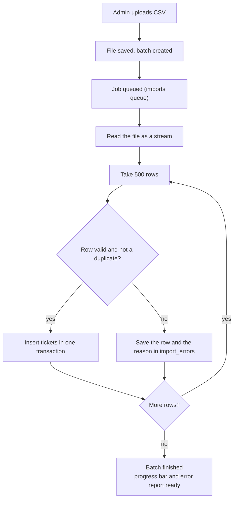
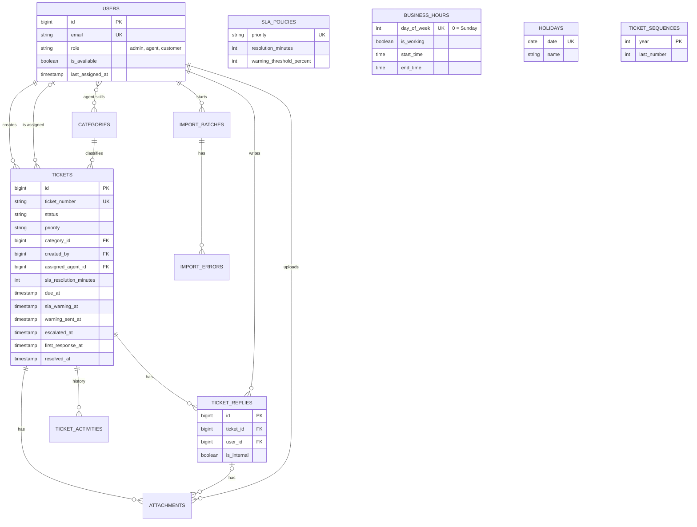

# Support Ticket & SLA System

A support desk built with **Laravel 12**. Customers open tickets, agents work on them, and admins control the rules. Every ticket gets a **resolution deadline (SLA) counted in business hours**. When the deadline is close or missed, the system warns and escalates by itself.

Everything runs in Docker: one command starts the app, database, queue worker, scheduler, mail catcher and a database UI.

---

## Table of contents

1. [What it does](#1-what-it-does)
2. [Quick start](#2-quick-start)
3. [URLs and login credentials](#3-urls-and-login-credentials)
4. [Database: migration, seed, access](#4-database-migration-seed-access)
5. [How the project works](#5-how-the-project-works)
6. [Worked example](#6-worked-example)
7. [Project structure](#7-project-structure)
8. [Configuration](#8-configuration)
9. [Useful commands](#9-useful-commands)
10. [Testing](#10-testing)
11. [Troubleshooting](#11-troubleshooting)
12. [Security notes and known limits](#12-security-notes-and-known-limits)

---

## 1. What it does

| Area | Features |
|---|---|
| **Tickets** | Create, edit, list, search. Unique number such as `TKT-2026-000001`. Active and Resolved tabs. |
| **Roles** | Admin, Agent, Customer. Each sees and does only what the role allows. |
| **Assignment** | Automatic (skill match, then fewest active tickets) or manual by admin. Agents can claim from the pool. No double assignment, even when two agents click at the same moment. |
| **Conversation** | Replies, private **internal notes** (customers never see them), file attachments. |
| **SLA** | Deadline per priority, counted only in **working hours**, skipping weekends and holidays. Editable by the admin without code changes. |
| **Escalation** | A scheduler warns at 75 percent of the time and escalates when the deadline passes. It never fires twice for the same ticket. |
| **Notifications** | Email (caught by Mailpit in development) and an in-app bell. |
| **Search and filter** | By number, keyword, status, priority, category, agent, customer, date range and SLA state. |
| **CSV import** | Large files, processed in the background in chunks, with a progress bar and a downloadable error report. |
| **Dashboard** | Open, unassigned, critical, breached and approaching counts, scoped to what the user may see. |
| **Audit trail** | Every change to a ticket is written to its history. |

**Stack:** PHP 8 / Laravel 12, MySQL 8, Redis (cache and queue), Blade + Tailwind (Breeze), Docker Compose.

---

## 2. Quick start

**Requirements:** Docker with Compose v2, and Git. On Windows use WSL2 or Git Bash (the setup script is a bash script).

```bash
# 1. Get the code
git clone https://github.com/shakil-official/support-ticket-sla-system.git
cd support-ticket-sla

# 2. Create .env (generates APP_KEY and random database passwords)
chmod +x docker/setup.sh docker/entrypoint.sh
./docker/setup.sh

# 3. Build and start everything (first build takes a few minutes)
docker compose up -d --build

# 4. Watch it come up (migrations and seeding run automatically)
docker compose logs -f app
```

When the log shows the server running, open **http://localhost:8300** and log in with the credentials below.

> No Bash available? Copy `.env.example` to `.env` and fill `APP_KEY` (`base64:` followed by `openssl rand -base64 32`), `DB_PASSWORD` and `DB_ROOT_PASSWORD` yourself. The `app` container refuses to start when `APP_KEY` is empty.

**Stop and start again**

```bash
docker compose stop          # stop, keep data
docker compose up -d         # start again
docker compose down -v       # remove containers AND all data (fresh start)
```

---

## 3. URLs and login credentials

| Service | URL | Notes |
|---|---|---|
| **Application** | http://localhost:8300 | Login page: `/login` |
| **Mailpit** (all outgoing email) | http://localhost:8325 | No login |
| **Adminer** (database UI) | http://localhost:8380 | See [section 4](#4-database-migration-seed-access) |
| MySQL from your computer | `127.0.0.1:3320` | For DBeaver, TablePlus and similar |

Change a port in `.env` (`APP_PORT`, `MAILPIT_PORT`, `ADMINER_PORT`, `FORWARD_DB_PORT`) and run `docker compose up -d` if it clashes with something else.

### Demo accounts

Created by the seeder (only when `APP_ENV` is not `production`). Every password is `password`.

| Role | Email | Password | Skills / notes |
|---|---|---|---|
| **Admin** | `admin@example.com` | `password` | Settings, team, import, every ticket |
| Agent | `agent1@example.com` | `password` | Billing, Account |
| Agent | `agent2@example.com` | `password` | Technical, Bug Report |
| Agent | `agent3@example.com` | `password` | No skills (generalist) |
| Customer | `customer1@example.com` | `password` | |
| Customer | `customer2@example.com` | `password` | |

**Example:** open `/login`, enter `customer1@example.com` and `password`, click **New ticket**, choose category *Billing* and priority *High*. The ticket is assigned to `agent1@example.com` within a few seconds. Log in as `agent1` in a private window to see it. Open Mailpit to read the emails.

---

## 4. Database: migration, seed, access

### Migration and seed (automatic)

The `app` container runs these on every start, so a fresh `docker compose up -d --build` gives you a ready database:

```text
php artisan migrate --force      # creates all tables
php artisan db:seed --force      # categories, SLA policies, office hours, demo users
```

The seeders use `firstOrCreate`, so re-running them never overwrites what an admin changed. To skip seeding, set `RUN_SEEDERS=false` in `.env`.

### Run them by hand

```bash
docker compose exec app php artisan migrate --force
docker compose exec app php artisan db:seed --force

# DANGER: drops every table and starts over
docker compose exec app php artisan migrate:fresh --seed --force
```

### What gets seeded

| Data | Values |
|---|---|
| Categories | General, Billing, Technical, Account, Bug Report |
| SLA (business hours) | Low 48 h, Medium 24 h, High 8 h, Critical 2 h. Warning at 75 percent. |
| Office hours | Sunday to Thursday, 09:00 to 18:00 (Friday and Saturday off) |
| Users | The demo accounts above |

### Open the database in Adminer

Go to **http://localhost:8380** and enter:

| Field | Value |
|---|---|
| System | MySQL |
| Server | `mysql` (not `localhost`) |
| Username | `support_desk` |
| Password | the `DB_PASSWORD` line in your `.env` |
| Database | `support_desk` |

```bash
grep -E "DB_USERNAME|DB_PASSWORD|DB_ROOT_PASSWORD|DB_DATABASE" .env
```

Useful queries:

```sql
SELECT ticket_number, status, priority, assigned_agent_id, due_at, escalated_at FROM tickets ORDER BY id DESC;
SELECT created_at, type, description FROM ticket_activities WHERE ticket_id = 1 ORDER BY id;
```

> If you change `sla_policies`, `business_hours` or `holidays` directly in Adminer, also run `docker compose exec app php artisan cache:clear`. Changing them in **Admin > Settings** clears the cache for you.

---

## 5. How the project works

### 5.1 The containers



| Container | Job |
|---|---|
| `app` | Serves the website. Runs migrations and seeders on start. |
| `queue` | Background worker: emails, auto-assign, SLA jobs, CSV import. Queue priority is `sla`, then `notifications`, then `default`, then `imports`. |
| `scheduler` | Runs `tickets:check-sla` every 5 minutes and `tickets:auto-close` daily. |
| `mysql` / `redis` | Data, and cache plus queue. |
| `mailpit` / `adminer` | Development tools: fake inbox and database UI. |

### 5.2 One request, layer by layer



The rule that keeps this safe: the browser can never choose its own `status`, `role` or `created_by`. Only the server sets them.

### 5.3 What happens when a customer creates a ticket



### 5.4 Ticket status flow



Resolved tickets close automatically after `TICKET_AUTO_CLOSE_DAYS` days (default 3). A closed ticket cannot be reopened.

### 5.5 Automatic assignment



**Two agents click Accept at once:**



### 5.6 SLA in business hours

The clock only runs during office hours. Example: **High priority = 8 business hours**, created Thursday 16:00 (office is Sunday to Thursday, 09:00 to 18:00).



- The deadline and warning time are **stored on the ticket when it is created**. Changing the policy later affects only new tickets.
- Holidays are skipped like weekends.
- Admins change minutes, warning percent, office hours and holidays in **Admin > Settings**. No code change needed.

### 5.7 Warning and escalation (scheduler)



### 5.8 CSV import



A sample file is in `database/samples/tickets-sample.csv` (7 rows: 4 valid, 1 duplicate, 2 invalid). Imported tickets send no emails and are not auto-assigned.

### 5.9 Who can do what

| Action | Customer | Agent | Admin |
|---|:--:|:--:|:--:|
| Create a ticket | yes | yes | yes |
| See tickets | own only | own and the unassigned pool | all |
| Edit subject and description | own, while Open | assigned to them | all |
| Change priority or category | no | assigned to them | all |
| Claim from the pool | no | yes | n/a |
| Assign or reassign | no | no | yes |
| Reply | own tickets | assigned tickets | all |
| Write or read internal notes | no | yes | yes |
| Change status | confirm close or reopen own Resolved ticket | assigned tickets | all |
| See the activity history | no | yes | yes |
| SLA, office hours, holidays, team, CSV import | no | no | yes |

### 5.10 Main tables



Rules (SLA, office hours, holidays) are **data**, not code. That is why an admin can change them live.

---

## 6. Worked example

Karim (`customer1@example.com`) opens a ticket on **Thursday 16:00** (Dhaka time):

| Field | Value |
|---|---|
| Subject | Wrong amount on the September invoice |
| Category / Priority | Billing / High |
| Attachment | `invoice.pdf` |

What the system does:

| Step | Result |
|---|---|
| Ticket number | `TKT-2026-000001` |
| SLA | High = 8 business hours. Warning **Sun 13:00**, due **Sun 15:00** |
| Auto-assign | Billing skill, so `agent1@example.com`. Status becomes *In Progress* |
| Email | Karim gets a confirmation. Agent One gets an assignment email. Both visible in Mailpit |
| History | *Ticket created*, *1 file attached*, *Status changed*, *Auto-assigned* |

Then:

1. Agent One replies, so the status becomes **Waiting for Customer** and `first_response_at` is set.
2. Agent One writes an **internal note**: "Asked finance." Karim cannot see it.
3. Karim replies, so the status goes back to **In Progress**.
4. If nobody resolves it by Sunday 13:00, the scheduler sends a **warning**. After 15:00 it **escalates** and notifies the agent and all admins.
5. Agent One marks it **Resolved**. Three days later it closes automatically.

You can test the escalation yourself: in Adminer, set `due_at` and `sla_warning_at` of ticket 1 to the past, then run `docker compose exec app php artisan tickets:check-sla` and watch `docker compose logs -f queue` and Mailpit.

---

## 7. Project structure

```text
.
├── app/
│   ├── Console/Commands/     check-sla, auto-close, race-demo
│   ├── Enums/                TicketStatus, TicketPriority, UserRole, ...
│   ├── Events/ Listeners/    TicketCreated -> auto-assign, notifications
│   ├── Filters/              TicketFilter (search and filters)
│   ├── Http/                 Controllers, FormRequests
│   ├── Jobs/                 WarnTicketSla, EscalateTicketSla, ProcessTicketImport
│   ├── Models/ Policies/     Eloquent models, permission rules
│   ├── Notifications/        mail and bell notifications
│   └── Services/             TicketService, TicketAssignmentService, Sla/, Import/
├── config/tickets.php        project settings (prefix, limits, chunk size)
├── database/                 migrations, seeders, factories, samples/
├── docker/                   setup.sh, entrypoint.sh
├── resources/views/          Blade pages
├── routes/                   web.php, auth.php, console.php (scheduler)
├── tests/                    Unit and Feature tests
├── Dockerfile
└── docker-compose.yml
```

---

## 8. Configuration

All settings live in `.env`. After editing it, run `docker compose up -d` (a plain `restart` does not re-read it).

| Key | Default | Meaning |
|---|---|---|
| `APP_PORT`, `MAILPIT_PORT`, `ADMINER_PORT`, `FORWARD_DB_PORT` | 8300, 8325, 8380, 3320 | Ports published on your computer |
| `DB_DATABASE`, `DB_USERNAME`, `DB_PASSWORD` | `support_desk` | Database login (password generated by `setup.sh`) |
| `TICKET_PREFIX` | `TKT` | Ticket number prefix |
| `BUSINESS_TIMEZONE` | `Asia/Dhaka` | Time zone for office hours. Data is stored in UTC |
| `TICKET_AUTO_ASSIGN` | `true` | Turn automatic assignment on or off |
| `TICKET_AUTO_CLOSE_DAYS` | `3` | Days a Resolved ticket waits before closing (0 turns it off) |
| `RUN_SEEDERS` | `true` | Seed on container start |
| `SESSION_LIFETIME` | `120` | Login session in minutes |

SLA minutes, office hours and holidays are **not** in `.env`. Change them in **Admin > Settings**.

---

## 9. Useful commands

```bash
# Logs
docker compose logs -f app
docker compose logs -f queue        # background jobs and emails
docker compose logs -f scheduler    # what runs every minute

# Scheduler
docker compose exec app php artisan schedule:list
docker compose exec app php artisan tickets:check-sla      # run the SLA check now
docker compose exec app php artisan tickets:auto-close

# Queue
docker compose exec app php artisan queue:failed
docker compose exec app php artisan queue:retry all

# Cache and demo
docker compose exec app php artisan cache:clear
docker compose exec app php artisan tickets:race-demo --rounds=25   # proves no double assignment

# Open a shell
docker compose exec app sh
```

After changing PHP code, views or config files: `docker compose up -d --build` (the code is copied into the image).

---

## 10. Testing

```bash
docker compose exec app php artisan test
docker compose exec app php artisan test --filter=SlaCalculatorTest
```

Tests run on an in-memory SQLite database and refuse to start against MySQL, so your development data is safe. They cover the business-hours maths, assignment races, permissions, escalation (never twice), CSV import, search and the dashboard.

---

## 11. Troubleshooting

| Problem | Fix |
|---|---|
| `port is already allocated` | Change the port in `.env`, then `docker compose up -d` |
| `APP_KEY is empty` and the app container exits | Run `./docker/setup.sh` (or `rm .env && ./docker/setup.sh` if an earlier run failed) |
| Strange database errors such as a missing `migrations` table | Reset: `docker compose down -v && docker compose up -d --build` |
| Changed `.env` but nothing happened | Use `docker compose up -d`, not `restart` |
| Changed code but the page is the same | `docker compose up -d --build` |
| No emails appear | Check `docker compose logs -f queue`, then open http://localhost:8300 and Mailpit at http://localhost:8325 |
| Tickets are not auto-assigned | The `queue` container must be running. Check that an agent is *available* |
| SLA values edited in Adminer have no effect | `docker compose exec app php artisan cache:clear` |
| Large uploads fail | PHP's built-in limits apply. Raise `upload_max_filesize` and `post_max_size` in the `Dockerfile` `CMD` (`php -d ... -S`) |

---

## 12. Security notes and known limits

**Security**

- `role`, `status` and `created_by` can never be set from a form.
- Permissions are checked twice: in policies (one record) and in queries (lists never contain other people's tickets).
- Internal notes are filtered in the query itself, not hidden in the template.
- Attachments are stored privately under random names and served only after a permission check.
- Login is rate limited and the session id changes at login.
- The demo accounts and the exposed ports are for **development only**. Change every password before any real deployment.

**Known limits**

- The SLA clock keeps running while a ticket waits for the customer.
- One business calendar and one time zone for the whole company.
- A ticket escalates once (a single level).
- A ticket that could not be auto-assigned stays in the pool until an agent claims it or an admin assigns it.
- The container uses PHP's built-in server, which is fine for development and review. For production use nginx with php-fpm, HTTPS and a real SMTP service.
